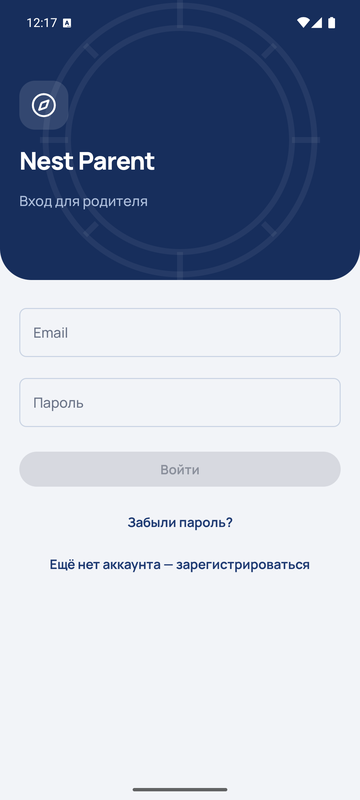
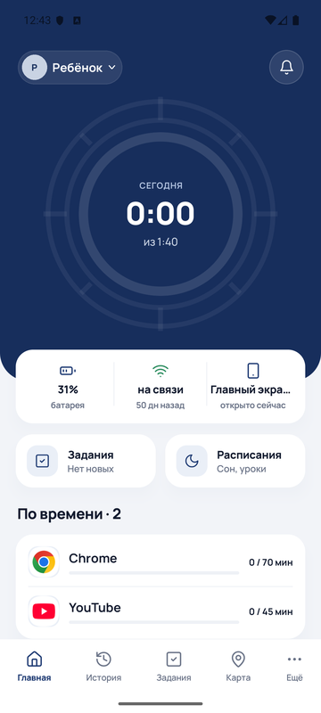
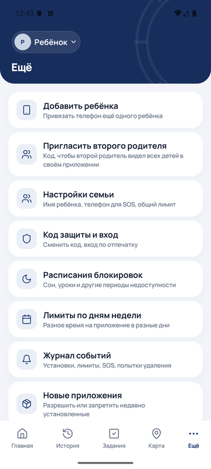
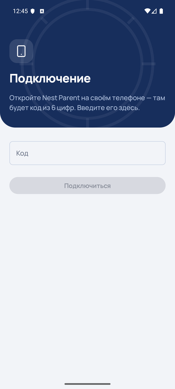

# Nest Kid — родительский контроль

Приложение для родительского контроля: приложение родителя (`app-parent`) удалённо управляет и следит за телефоном ребёнка (`app-child`), плюс опциональный клиент для Windows-ноутбука ребёнка (`windows-client`). Данные синхронизируются через Firebase Firestore в реальном времени — отдельного бэкенд-сервера нет (используется бесплатный план Firebase Spark, без Cloud Functions: вся бизнес-логика находится в самих приложениях, а изоляция данных между семьями обеспечивается правилами безопасности Firestore, `firestore.rules`).

## Скриншоты

Сняты с эмулятора (Pixel 7, Android 16). Имя ребёнка на скриншотах заменено на «Ребёнок».

| Вход родителя | Главная | Ещё | Nest Kid: подключение |
|---|---|---|---|
|  |  |  |  |

## Дизайн

Оба приложения сделаны в одном стиле — «A3 · Компас»: шрифт Manrope, тёмно-синяя шапка с ключевой цифрой (на главной родителя — кольцо экранного времени) и водяным знаком компаса, белые карточки с мягкой тенью, тонкие линейные иконки Lucide, только светлая тема. Цвета, типографика и общие компоненты (`NestHeader`, `NestCard`, `NestBottomBar`, `ProgressRing`, `NestOnboardingScreen`) лежат в `core/src/main/java/com/teo/core/ui/` — новые экраны собираются из них. Лицензии шрифта и иконок — в [THIRD_PARTY_NOTICES.md](THIRD_PARTY_NOTICES.md).

## Структура проекта

| Модуль | Что это |
|---|---|
| `app-parent` | Android-приложение родителя (Kotlin + Jetpack Compose) |
| `app-child` | Android-приложение ребёнка (Kotlin + Jetpack Compose) |
| `core` | Общий модуль: модели данных, репозитории Firestore, тема и UI-компоненты A3, иконки и шрифт — используется обоими приложениями |
| `windows-client` | Клиент для Windows (.NET): фоновая служба + установщик, для лимитов времени на ноутбуке ребёнка |
| `firestore.rules` | Правила безопасности Firestore — единственная точка контроля доступа к данным семьи |

## Основные возможности

**У ребёнка (`app-child`):**
- Лимиты времени на конкретные приложения и общий дневной лимит на телефон
- Полная или частичная блокировка приложений, расписания (сон, уроки и т.д.)
- Отслеживание истории в YouTube и Chrome через Accessibility Service
- Геолокация, кнопка SOS (звонок родителю), задания и навыки с наградой в виде времени
- Защита от удаления приложения и отключения администратора устройства (Device Admin) — снимается кодом родителя, в том числе без интернета
- Экраны согласия при первом запуске: что увидят родители и отдельное объяснение перед каждым чувствительным разрешением
- «Послушать вокруг» — прослушивание звука с телефона по запросу через WebRTC

**У родителей (`app-parent`):**
- Несколько детей: переключатель ребёнка в шапке, «Ещё» → «Добавить ребёнка»
- Два родителя: «Ещё» → «Пригласить второго родителя» даёт код, второй родитель вводит его на экране привязки («Я второй родитель»); оба видят всех детей и получают уведомления
- Дашборд с установленными приложениями, статистикой использования, картой местоположения
- Утверждение новых установленных приложений, заданий, запросов на доп. время
- Журнал событий (SOS, попытки удаления, новые установки и т.д.) с уведомлениями
- Настройка лимитов, расписаний, привязка/переподключение устройств ребёнка
- Код защиты на выбор: PIN от 6 цифр, пароль или графический ключ; смена кода, вход по отпечатку, «Забыли код?» через пароль аккаунта
- «Забыли пароль?» на экране входа (письмо Firebase), удаление аккаунта со всеми данными
- Блокировка телефона ребёнка в авиарежиме и без геолокации — по желанию, отдельными переключателями

## Модель данных

Каждый ребёнок — отдельный документ `families/{id}` со всеми своими подколлекциями (правила, статистика, геолокация и т.д.). В поле `parentUids` перечислены все родители, которые им управляют. Приложение родителя работает с выбранным ребёнком (выбор хранится локально на телефоне). PIN защиты и телефон для SOS общие для всех детей и записываются во все документы. Приглашения вторых родителей хранятся в `parentInvites/{code}`.

## Стек

- Kotlin, Jetpack Compose, Hilt (DI), Room (локальный кэш), WorkManager (фоновые задачи); target API 36 (Android 16)
- Firebase Crashlytics (отчёты о сбоях)
- Firebase Auth + Firestore (единственный бэкенд)
- WebRTC (для «Послушать вокруг»)
- .NET 7 (Windows-клиент)

## Начало работы

1. Настроить Firebase-проект — см. [SETUP_FIREBASE.md](SETUP_FIREBASE.md) (нужно сделать один раз перед первой сборкой).
2. Собрать оба приложения:
   ```
   ./gradlew :app-parent:assembleDebug :app-child:assembleDebug
   ```
   APK появятся в `app-parent/build/outputs/apk/debug/` и `app-child/build/outputs/apk/debug/`.
   Для установки родным (release-сборка, ставится поверх без переустановки): положить в корень проекта `keystore.properties` (`storeFile`, `storePassword`, `keyAlias`, `keyPassword` — файл в git не попадает) и собрать `./gradlew :app-parent:assembleRelease :app-child:assembleRelease`.
3. Установить `app-parent` на телефон родителя, `app-child` — на телефон ребёнка, привязать по коду.
4. Чек-лист проверки основных сценариев на реальных телефонах — см. [TESTING.md](TESTING.md).

## Важно

- Правила `firestore.rules` **не деплоятся автоматически** — после любого изменения файла нужно вручную вставить его содержимое в Firebase Console → Firestore → Rules → Publish.
- Оба приложения запрашивают ряд специальных разрешений (Accessibility, Device Admin, Usage Access, наложение поверх экрана) — без них мониторинг и блокировки не работают.
